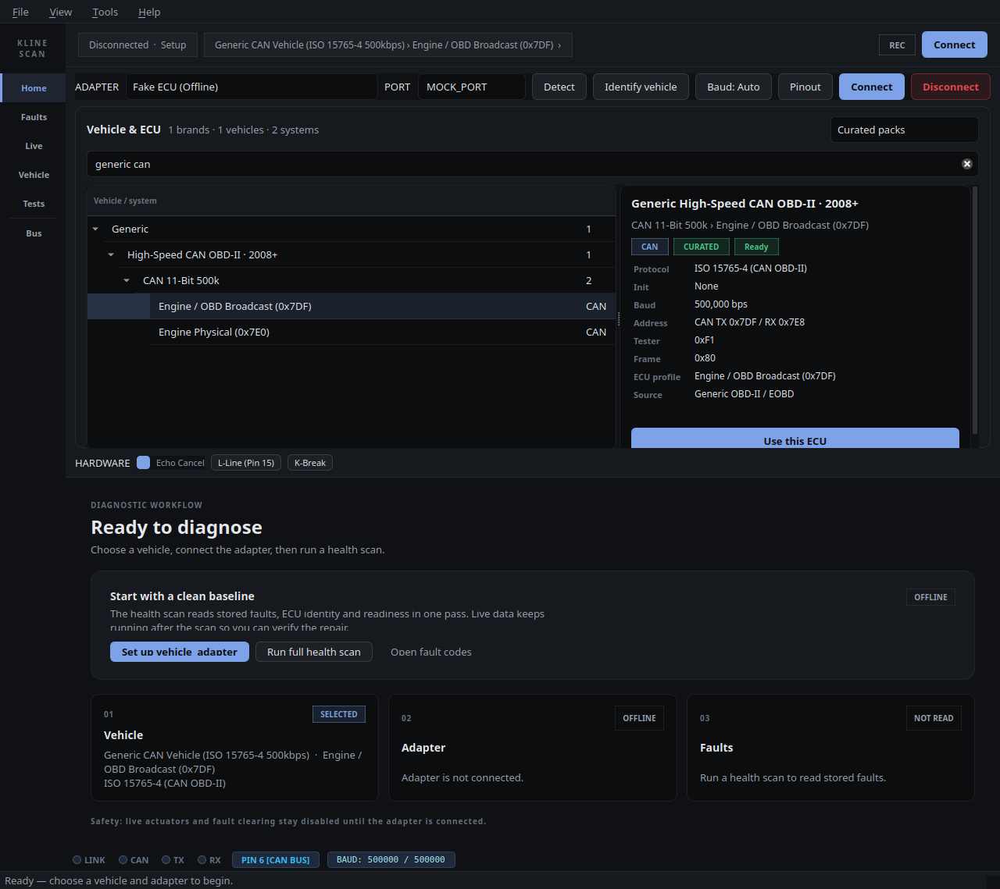
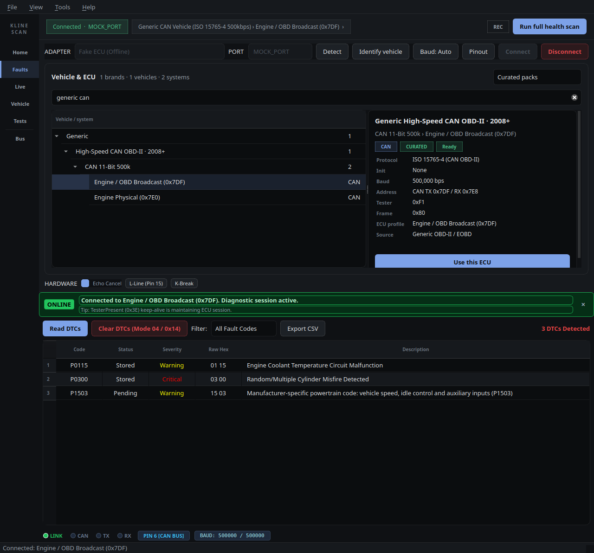
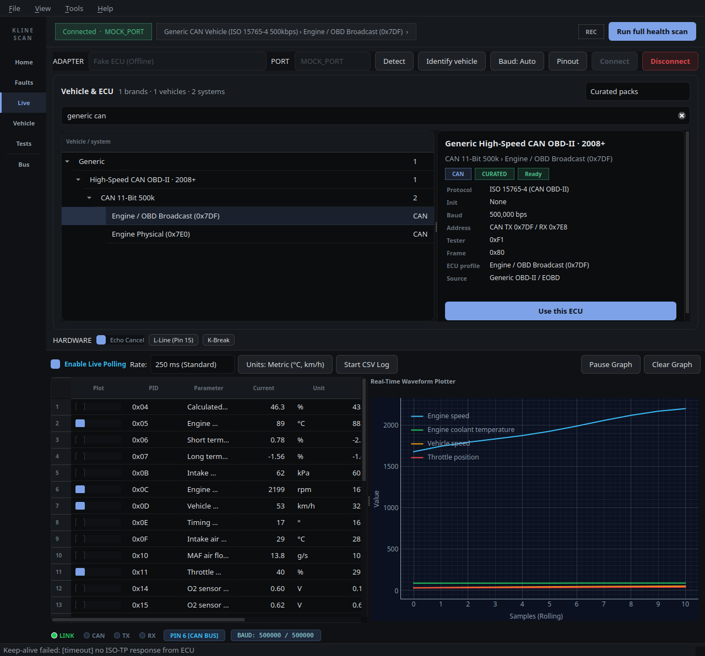

# KLineScan

A native Python + PyQt6 diagnostic suite for K-line, CAN and DoIP vehicles.

[](LICENSE)
[](https://www.python.org/)
[](https://github.com/fazyamir/KLineScan/actions/workflows/ci.yml)
[](https://github.com/fazyamir/KLineScan/releases)

> **Disclaimer — read this first.** KLineScan is a personal project. It is
> provided "as is", without warranty of any kind. The author is not responsible
> for how others use it, for any damage to vehicles, equipment or people, or for
> any legal consequence of use. You are responsible for complying with local
> laws and for only working on vehicles you own or are authorised to service.
> Diagnostic commands can change vehicle state. Use at your own risk.

## Status

**Alpha.** The UI, transports, protocol state machines and the offline Mock ECU
work and are covered by an automated test suite. No adapter or vehicle profile
in this repository has been validated on a real vehicle yet, so treat every
connection as untested until you verify it yourself. Calls fail explicitly
instead of inventing data, and write operations are gated behind a safety layer.

What works today:
- K-line (ISO 9141-2, KWP2000, KWP1281), CAN OBD-II (ISO 15765-4), UDS over CAN,
  ISO-TP and Nissan Consult I.
- DTC read/clear, live data, freeze frame, ECU identification, readiness monitors,
  actuator tests defined by a vehicle pack, session recording and replay.
- Offline Mock ECU mode for trying the whole UI without a car.

What is **not** hardware-verified: every adapter/protocol combination in the
tables below. The golden transcripts in `tests/golden/` are synthetic fixtures,
not vehicle captures.

## Screenshots

Captured from the offline Mock ECU mode on Linux.







## Features

- **Vehicle packs** — data-driven JSON definitions in `packs/`; add a vehicle
  without touching Python.
- **Adapter discovery** — probes serial, FTDI, ELM327, J2534, SocketCAN and DoIP.
- **K-line first** — high-resolution 5-baud slow init, KWP2000 fast init, echo
  cancellation, timing (W1–W5, P1–P4) and optional D2XX bit-banging.
- **CAN and UDS** — ISO-TP single/multi-frame reassembly, OBD-on-UDS fallback,
  configurable CAN IDs and bitrates.
- **Live data** — polls every supported PID, keeps min/max/avg, plots up to eight
  traces, and can log to CSV.
- **Diagnostics** — stored/pending/permanent DTCs, freeze frame, VIN, calibration
  IDs, readiness monitors and printable HTML reports.
- **Safety gates** — clear-DTC, actuator and raw-send operations are refused on
  unverified targets and while replaying a recording.
- **Recording** — CSV session recording with timeline playback.
- **Self-update** — opt-in update check against the public `main` branch.

## Supported hardware

The recommended adapter is a **KKL / FTDI-based K-line cable**. It is the
simplest way to reach ISO 9141-2 and KWP2000 ECUs on pin 7 and needs no
protocol firmware of its own.

| Adapter | Transport | Status |
|---|---|---|
| **KKL / FTDI K-line cable (recommended)** | `kl_serial`, `ftdi_direct` | Implemented; untested on a vehicle |
| ELM327 / OBDLink (USB, Bluetooth, Wi-Fi, BLE) | `elm327` | Implemented; untested on a vehicle |
| J2534 PassThru (Tactrix, Mongoose, Scanmatik, VCX) | `j2534` | Implemented; untested on a vehicle |
| SocketCAN / `python-can` | `socketcan` | Implemented; untested on a vehicle |
| VAG K+CAN Commander 1.4 | `kcan` | Experimental; untested on a vehicle |
| DoIP / ISO 13400 (optional `doipclient`) | `doip` | Experimental; untested on a vehicle |
| Offline Mock ECU | `fake_ecu` | Works offline; used by the test suite |
| Recorded session replay | `replay` | Works offline |

**Wiring note for a KKL cable:** the K-line signal is on **pin 7**, chassis
ground on **pin 4** and signal ground on **pin 5**. Connect both grounds; a
missing signal ground is the usual cause of a cable that powers up but never
receives. Standard KKL cables only drive pin 7 — move the cable's K-line lead
if a module uses pin 8, 12 or 14.

Looking for a cable? Try a
[KKL / FTDI K-line OBD-II parts search](https://www.google.com/search?q=KKL+FTDI+K-line+OBD2+cable).

## Supported protocols

| Protocol | Status |
|---|---|
| ISO 9141-2 (5-baud slow init, K-line) | Implemented; untested on a vehicle |
| ISO 14230-4 KWP2000 (fast and slow init) | Implemented; untested on a vehicle |
| VAG KWP1281 | Implemented; untested on a vehicle |
| ISO 15765-4 CAN OBD-II | Implemented; tested against simulated ECUs only |
| ISO 14229 UDS over CAN | Implemented; untested on a vehicle |
| ISO 15765-2 ISO-TP | Implemented; covered by unit tests |
| Nissan Consult I | Read-only; untested on a vehicle |
| ISO 13400 DoIP | Optional; untested on a vehicle |

## Supported vehicles

The table is generated from `packs/*.json`. Every entry is **defined, not
hardware-verified** until someone submits a verified capture.

| Pack | Make | Model | Years | Protocol(s) | Modules | Verification |
|---|---|---|---|---|---:|---|
| Generic OBD-II / EOBD | Generic | Standard OBD-II | 1996+ | ISO 9141-2 (5-Baud Slow Init) | 1 | defined, not hardware-verified |
| Generic OBD-II / EOBD | Generic | High-Speed CAN OBD-II | 2008+ | ISO 15765-4 (CAN OBD-II) | 2 | defined, not hardware-verified |
| Hyundai & Kia | Hyundai | Elantra / Accent / Matrix | 2000-2006 | ISO 14230 (KWP2000 Fast Init) | 4 | defined, not hardware-verified |
| Hyundai & Kia | Kia | Rio / Cerato | 2004-2010 | ISO 14230 (KWP2000 Fast Init) | 2 | defined, not hardware-verified |
| Nissan / Infiniti (Consult I, pre-OBD) | Nissan | Consult I engine ECU | 1989-2000 | `NISSAN_CONSULT` | 1 | defined, not hardware-verified |
| Toyota & Honda | Toyota | Yaris / Echo / Vitz | 1999-2005 | ISO 9141-2 (5-Baud Slow Init) | 2 | defined, not hardware-verified |
| Toyota & Honda | Honda | Civic / Accord | 1998-2006 | ISO 9141-2 (5-Baud Slow Init) | 2 | defined, not hardware-verified |
| Volkswagen / Audi / Skoda / Seat (VAG) | Volkswagen | Golf IV / Passat B5 / Jetta | 1997-2005 | ISO 14230 (KWP2000 Fast Init) | 3 | defined, not hardware-verified |
| Volkswagen / Audi / Skoda / Seat (VAG) | Audi / Volkswagen | A4 / A6 / Golf VI / Tiguan | 2008-2015 | ISO 14229 (UDS over CAN) | 2 | defined, not hardware-verified |

## Installation

KLineScan is tested with **Python 3.12** on Linux. The same steps work on
Windows and macOS.

```bash
git clone https://github.com/fazyamir/KLineScan.git
cd KLineScan

python -m venv venv
# Linux / macOS:
source venv/bin/activate
# Windows PowerShell:
# venv\Scripts\Activate.ps1

pip install -r requirements.txt
```

### Linux serial permissions

Add your user to the `dialout` group so the app can open USB serial adapters,
then log out and back in (or run `newgrp dialout`):

```bash
sudo usermod -aG dialout "$USER"
```

### Windows

Install the FTDI virtual COM port driver supplied by the chip vendor before
plugging in a KKL cable. This project does not bundle or download drivers; check
the vendor's current download yourself.

### Run

```bash
python main.py
```

The app can also be installed and started as a command:

```bash
pip install -e .
klinescan
```

**Trying the UI without a car:** leave the adapter set to
`Fake ECU (Offline)` and the port as `MOCK_PORT`, choose a vehicle module in the
connection panel and press **Connect**. The Mock ECU simulates engine physics,
DTCs and live data. Logs go to `~/.klinescan/logs/klinescan.log`.

### Command-line decoder

The package also ships a read-only decoder for user-supplied diagnostic
container files. It bundles no container images or catalogues:

```bash
python -m klinescan.containers decode /path/to/your/files -o build/decoded
```

## Updating

On startup KLineScan checks the version published on the public `main` branch.
The check runs in the background with a timeout, so it never blocks the UI, and
network, rate-limit or parsing failures are logged and ignored. If a newer
version exists, a dialog lists the new commit messages and asks before doing
anything.

When you confirm, the app updates in one of two ways:

- **Git clone:** `git pull --ff-only origin main` followed by
  `pip install -r requirements.txt`. The working tree must be clean; otherwise
  the update is refused.
- **Plain download:** the `main` archive is downloaded over HTTPS, verified to
  contain the expected project files, unpacked over the current installation,
  and rolled back from a backup on failure.

The app then asks to restart. To turn the startup check off, use
**Help → Check Automatically on Startup**, or set `"check_for_updates": false`
in `~/.klinescan/config.json`. **Help → Check for Updates...** triggers a manual
check at any time.

## Testing

```bash
pytest -q
```

The suite runs without hardware. It covers transports, ISO-TP, KWP2000,
KWP1281, UDS, the fake ECU, sessions, traces, the container decoder and the
update checker. Golden transcripts in `tests/golden/` are synthetic conformance
fixtures, not vehicle captures.

## Project layout

```text
KLineScan/
├── main.py
├── klinescan/
│   ├── app.py                  # Qt application entry point
│   ├── service.py              # headless diagnostic service
│   ├── updates.py              # self-update check/apply
│   ├── containers/             # user-supplied container decoder
│   ├── core/                   # models, packs, trace, VIN, safety, ...
│   ├── protocols/              # ISO 9141-2, KWP2000, KWP1281, UDS, ISO-TP
│   ├── transport/              # KKL, FTDI, ELM327, J2534, CAN, DoIP, fake
│   ├── ui/                     # PyQt6 windows, tabs and widgets
│   └── workers/                # background scanner worker
├── packs/                      # vehicle definitions (JSON)
├── tests/                      # pytest suite and golden fixtures
├── docs/screenshots/           # README screenshots
├── tools/                      # build/diff/smoke helpers
├── requirements.txt
├── version.txt
└── LICENSE
```

## Contributing

Contributions are very welcome — especially verified vehicle captures,
protocol fixes and new pack entries. The flow is:

1. Fork the repository and create a branch.
2. Make your change and run `pytest -q`.
3. Open a pull request against `main`.

The owner reviews every pull request before merging. Please include a verified
capture (or a trace) for protocol/vehicle changes, or clearly say **"untested"**
if you could not verify it. Do **not** submit manufacturer service-manual text,
paid-database entries, or firmware images. See
[CONTRIBUTING.md](CONTRIBUTING.md) for details.

This project follows the [Contributor Covenant](CODE_OF_CONDUCT.md). Security
issues should be reported privately as described in [SECURITY.md](SECURITY.md).

## License

MIT. See [LICENSE](LICENSE).

Copyright (c) 2026 fazyamir.

**Disclaimer (repeated for emphasis):** this is a personal project provided "as
is", without warranty of any kind. The author is not responsible for how others
use it, for any damage to vehicles, equipment or people, or for any legal
consequence of use. Users are responsible for complying with local laws and for
only working on vehicles they own or are authorised to service.
